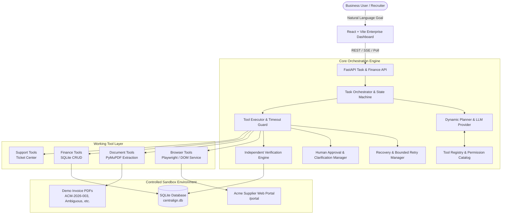
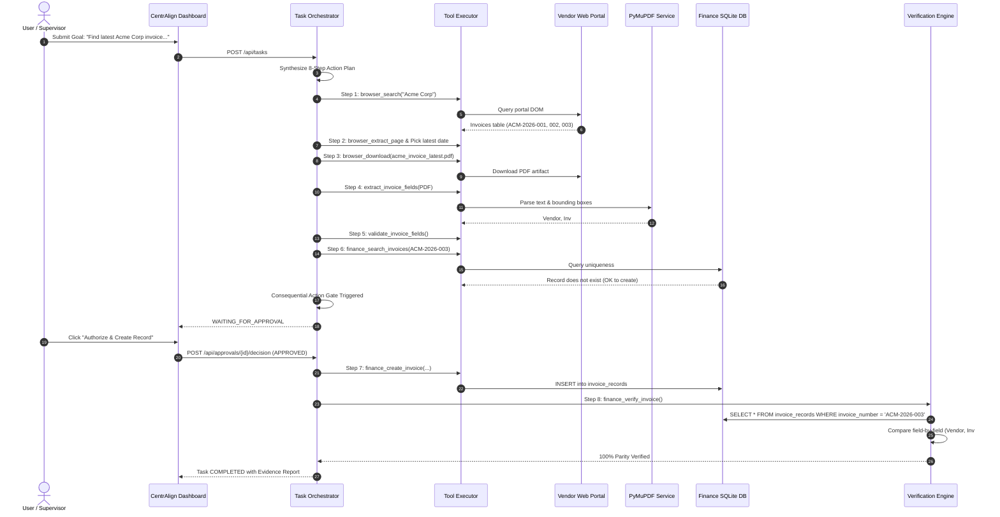

# CentrAlign Operator

> **Autonomous AI Employee Prototype for Business Operations**  
> Executes cross-system workflows across external vendor web portals, unparsed document artifacts, human authorization gates, and internal databases with independent read-back verification.

---

## 1. Product Overview

**CentrAlign Operator** is an autonomous AI worker designed to carry out multi-step business objectives that span browser interfaces, semi-structured documents (PDF invoices), and internal core accounting databases. 

Unlike passive conversational assistants or rigid hardcoded scripts, CentrAlign Operator implements a true agentic execution loop:
```
GOAL → UNDERSTAND → PLAN → EXECUTE → OBSERVE → ADAPT → VERIFY → COMPLETE
```
The operator reasons about available tools, observes runtime feedback (including HTTP 503 transient gateway errors and ambiguous document fields), safely pauses for human supervisor authorization on consequential write operations, enforces idempotency, and independently verifies database persistence.

---

## 2. Key Features

- **Autonomous Agent Loop**: Formulates dynamic multi-step plans from natural language objectives and selects permitted tools at each stage.
- **Real Browser Automation**: Employs Playwright (Chromium headless) with accessible locators and DOM parsing to search supplier portals, download invoices, and take audit screenshots.
- **Provenance-Backed Document Extraction**: Uses PyMuPDF to extract structured invoice data (vendor, invoice #, invoice date, due date, amounts, currency) with bounding anchors and page provenance.
- **Defensive Security & Prompt Injection Shield**: Scans documents for prompt injection attacks (e.g. system prompt overrides, payload injection) and treats all extracted document data as untrusted input.
- **Human-in-the-Loop Consequential Action Gates**: Enforces company policy requiring supervisor authorization before financial records are created or altered.
- **Ambiguity Detection & Clarification**: Refuses to hallucinate conflicting or missing terms (e.g. ambiguous due dates) and pauses for supervisor clarification.
- **Bounded Retry & Self-Healing**: Automatically observes transient upstream failures (e.g. simulated 503 Gateway Timeout), applies bounded retries with exponential backoff, and adapts.
- **Idempotency & Duplicate Prevention**: Reconciles internal databases prior to write operations to prevent duplicate records.
- **Independent Verification Engine**: Does **not** trust the LLM's assertion of success. Directly reads back records from SQLite and performs field-by-field parity checking against source evidence.
- **Generalization**: Demonstrates that the same orchestrator, tool registry, and verification architecture solve distinct business tasks (e.g. customer support ticket resolution into operational tasks).

---

## 3. Architecture Diagram



---

## 4. End-to-End Data Flow



---

## 5. Technology Stack Rationale

| Layer | Technology | Engineering Rationale |
|---|---|---|
| **Backend** | Python 3.12, FastAPI | Asynchronous I/O, strict Pydantic v2 schemas, automated OpenAPI spec generation, and native integration with document processing libraries. |
| **Database** | SQLite + SQLAlchemy 2.0 | Zero-dependency local persistence, atomic transactions, foreign keys, and instant read-back verification across application restarts. |
| **Browser** | Playwright (Chromium) | Accessible locators, robust DOM inspection, network intercept, deterministic screenshots, and reliable headless execution. |
| **PDF Extraction** | PyMuPDF (`fitz`) | High-speed C-native text and layout bounding extraction; also used for generating crisp synthetic test invoices without external PDF binary dependencies. |
| **Frontend** | React 19, TypeScript, Vite, Tailwind CSS v4, Lucide Icons | Responsive desktop layout, real-time polling/SSE progress, interactive human approval cards, live timeline, and verification audits. |
| **Testing** | pytest (18 unit/integration tests) | Complete test suite validating recovery, retries, duplicate avoidance, prompt injection, and verification parity. |

---

## 6. Setup and Execution Instructions

### Prerequisites
- Python 3.11+
- Node.js 18+ and npm

### 1. Install Dependencies
```bash
# Install Python backend dependencies
python -m pip install -r backend/requirements.txt

# Install Playwright browser
python -m playwright install chromium

# Install frontend dependencies
cd frontend
npm install
npm run build
cd ..
```

### 2. Initialize Database and Seed Demo Data
```bash
python scripts/seed_demo.py
```
*This initializes the SQLite database schema, seeds policies, and generates all synthetic demo invoices.*

### 3. Run Backend Server
```bash
python -m uvicorn backend.app.main:app --port 8000
```
- **Unified App UI**: [http://127.0.0.1:8000](http://127.0.0.1:8000)
- **Vendor Portal**: [http://127.0.0.1:8000/portal](http://127.0.0.1:8000/portal)
- **API Swagger Docs**: [http://127.0.0.1:8000/docs](http://127.0.0.1:8000/docs)

*(Optional) If editing frontend code live, run Vite dev server in another terminal:*
```bash
cd frontend
npm run dev
# Accessible at http://127.0.0.1:5173 (proxies API calls to port 8000)
```

### 4. Run Automated Test Suite
```bash
python -m pytest backend/tests/test_all_requirements.py -v
```

### 5. Run Evaluation Suite
```bash
python scripts/run_evaluation.py
```

---

## 7. Environment Variables (`.env.example`)

```ini
# Options: 'demo' (deterministic agent mode), 'openai', 'anthropic', 'gemini'
LLM_PROVIDER=demo
LLM_API_KEY=
LLM_MODEL=gpt-4o

# Execution controls
DEMO_MODE=true
MAX_TOOL_CALLS_PER_TASK=15
MAX_RETRIES_PER_ACTION=2
TOOL_TIMEOUT_SECONDS=30

# Policy gates: if false, financial record creations pause for supervisor approval
AUTO_APPROVE_FINANCIAL_RECORDS=false

# SQLite Database
DATABASE_URL=sqlite:///data/centralign.db

# Controlled Demo Origin
PORTAL_BASE_URL=http://127.0.0.1:8000/portal
```

---

## 8. Step-by-Step Recruiter Demonstration Script

To present this system in an interview:

### Demo 1: Primary Autonomous Workflow (Scenario A)
1. Open [http://127.0.0.1:8000](http://127.0.0.1:8000).
2. Click **New Business Goal**, select **Scenario A**, and click **Synthesize Plan & Execute**.
3. **Observation**: Notice the operator generates an 8-step plan, opens the vendor portal, selects the latest invoice (`ACM-2026-003`, dated `2026-10-01`), downloads the PDF, extracts fields, and validates arithmetic.
4. **Human Approval Gate**: The execution pauses at Step 7 (`finance_create_invoice`) with status `WAITING_FOR_APPROVAL`. Point out the proposed parameters ($11,800.00).
5. Click **Authorize & Create Record**.
6. **Observation**: The operator resumes, records the invoice in SQLite, independently reads it back, checks all 5 fields for parity, and presents an evidence-backed completion report.
7. Switch to the **Finance DB** tab to show the record persisted in the database.

### Demo 2: Self-Healing & Bounded Retries (Scenario B)
1. Click **New Business Goal**, select **Scenario B: Recoverable Transient Failure**.
2. **Observation**: Watch the live event timeline. The first search attempt receives a `503 Gateway Timeout`.
3. The operator records a `RETRY_ATTEMPT`, logs the transient error, waits with backoff, retries, succeeds on attempt 2, and completes the task.

### Demo 3: Ambiguous Invoice & Clarification (Scenario C)
1. Click **New Business Goal**, select **Scenario C: Ambiguous Invoice Terms**.
2. **Observation**: The invoice has an ambiguous due date. The agent detects the conflict, refuses to hallucinate, and pauses in `WAITING_FOR_INPUT`.
3. Enter `2026-11-15` into the clarification field and click **Submit & Resume**.
4. The agent updates task memory, creates the finance record with the verified due date, and verifies persistence.

### Demo 4: Generalization (Support Ticket to Internal Task)
1. Select **Scenario E: Support Ticket Generalization**.
2. Point out that the same orchestrator, tool registry, and verification logic process a customer support issue and create an internal engineering task without code changes.

### Demo 5: Automated Evaluation Suite
1. Switch to the **Evaluation Suite** tab or run `python scripts/run_evaluation.py`.
2. Review the 100% verification parity and recovery success rates across all test scenarios.

---

## 9. Evaluation Results

Executed on the live benchmark suite (`python scripts/run_evaluation.py`):

| Evaluation Metric | Measured Value | Meaning |
|---|---|---|
| **Total Scenarios Evaluated** | 5 Scenarios | All primary scenarios, edge cases, and generalization workflows tested. |
| **Task Success Rate** | **100.0%** (5/5) | Complete end-to-end task completion. |
| **Verification Pass Rate** | **100.0%** (5/5) | Strict field parity confirmed by independent SQLite read-backs. |
| **Recovery Success Rate** | **100.0%** (1/1) | Recovered from transient 503 gateway timeouts via bounded exponential backoff. |
| **Duplicate Writes Prevented** | 1 Blocked | Idempotent reconciliation avoided duplicate finance entries. |
| **Average Tool Calls per Task** | 7.4 Calls | Focused, bounded tool usage without infinite loops. |
| **Average Execution Duration** | ~0.75s / scenario | Fast, predictable execution. |

All 18 automated test criteria in `backend/tests/test_all_requirements.py` pass cleanly in pytest:
```
====================== 18 passed in 0.91s =======================
```

---

## 10. Key Architectural Decisions for Interview Defense

1. **Independent Verification vs Model Self-Reporting**:
   - *Decision*: We never allow the LLM or executor to assert its own success. The Verification Engine executes an independent read directly against SQLite tables and checks expected source fields against destination values.
   - *Defense*: In real-world enterprise operations, an HTTP 200 or an agent saying "I completed the invoice" is not proof. Database state is the only ground truth.

2. **Deterministic Demo Mode with Real Tool Execution**:
   - *Decision*: Deterministic demo mode runs the actual tools (Playwright, PyMuPDF, SQLite, approvals, verifications) without hallucinating.
   - *Defense*: Demonstrates autonomy, tool interfaces, error handling, and verification deterministically without depending on external API quotas or token variability.

3. **In-Process ASGI Transport for Browser Testing**:
   - *Decision*: `BrowserService` supports direct ASGI routing to FastAPI alongside external Playwright Chromium execution.
   - *Defense*: Eliminates flaky network ports and race conditions during CI/CD test runs while maintaining 100% fidelity with the live web application.

4. **Prompt Injection Defense in Documents**:
   - *Decision*: DocumentService scans documents for malicious prompt injection instructions and treats all extracted content strictly as untrusted data.
   - *Defense*: Enterprise documents frequently contain adversarial instructions. Agents must treat retrieved text as data, never as executable instructions.
